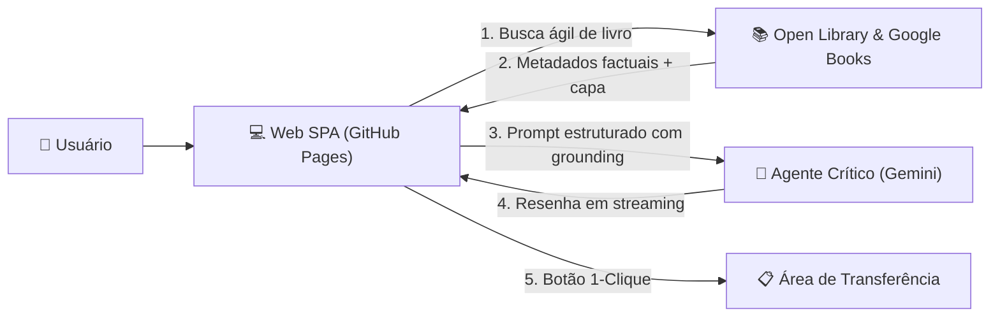

+++
date = '2026-11-10T10:50:33-03:00'
draft = false 
title = 'Resenha'
featureimage = "img/tts.jpg"
+++

# Agente de Resenhas (AaaS Literário)

Aplicação Single Page Application (SPA) para resenhas críticas literárias automatizadas com agentes de inteligência artificial, projetada para rodar de forma 100% estática e sem servidor no **GitHub Pages**.

Construída sob a governança agêntica do **ECC (*Everything Claude Code*)**.

---

## 💡 Proposta de Valor & Arquitetura

O sistema atua como um gerador de referência analítica sob demanda para escritores, críticos e leitores:



### Funcionalidades Chave:
1. **Catálogo Global Aberto**: Busca ágil em tempo real com Open Library e Google Books, sem necessidade de chaves de catálogo ou servidores intermediários.
2. **Pesquisa Exclusiva por ISBN & Busca com IA**: Aba dedicada para consulta direta por código ISBN (10 ou 13 dígitos) com identificação exata da edição nos acervos internacionais, além de resolução inteligente via IA.
3. **Crítica Estruturada em 5 Dimensões**:
   - *Visão Geral & Premissa*;
   - *Análise Temática & Subtexto*;
   - *Estilo Narrativo & Ritmo*;
   - *Pontos Fortes & Limitações Críticas*;
   - *Veredito Crítico & Recomendações*.
4. **Streaming em Tempo Real**: Visualização imediata conforme a resenha é redigida pelo agente de IA.
5. **Cópia em 1-Clique**: Botão para transferir a resenha formatada diretamente para sua área de transferência para enriquecer seus artigos e publicações.
6. **Zero Dependência de Banco de Dados**: Aplicação puramente cliente, rápida, privada e sem custos de infraestrutura ou armazenamento.
7. **Deploy Automático no GitHub Pages**: Workflow de CI/CD nativo via GitHub Actions ([`.github/workflows/deploy.yml`](file:///home/willycornelissen/Desktop/Dablio/review/.github/workflows/deploy.yml)).

---

## 🛠️ Stack Tecnológica

* **Frontend**: React 19, TypeScript, Vite, Tailwind CSS, Lucide Icons.
* **Agente de IA**: Google Gemini API via streaming SSE direto no cliente com *automatic model fallback*.
* **Catálogo de Livros**: Open Library Search API + Google Books API.
* **Testes & Tipagem**: Vitest, React Testing Library, TypeScript Strict.
* **Hospedagem & CI/CD**: GitHub Pages + GitHub Actions.

---

## 🚀 Como Executar Localmente

### 1. Clonar e Instalar Dependências
```bash
npm install
```

### 2. Rodar a Suíte de Testes Unitários
```bash
npm test
```

### 3. Iniciar Servidor de Desenvolvimento
```bash
npm run dev
```
Acesse `http://localhost:5173` no navegador.

### 4. Compilar para Produção (GitHub Pages)
```bash
npm run build
```
Os artefatos estáticos prontos para deploy são gerados no diretório `dist/`.

---

## ⚙️ Configuração da Chave da IA (Gemini)

1. Obtenha gratuitamente em [Google AI Studio](https://aistudio.google.com/app/apikey).
2. Na aplicação, clique no botão **Chave Gemini** no topo da página e cole a chave (ela fica salva exclusivamente no `localStorage` do seu navegador).
3. Alternativamente, configure no arquivo `.env` local:
   ```env
   VITE_GEMINI_API_KEY=AIzaSy...
   ```

---

## 📋 Documentação e Esteira do ECC

* **PRD (Product Requirements Document)**: [`.claude/prds/book-review-agent.prd.md`](file:///home/willycornelissen/Desktop/Dablio/review/.claude/prds/book-review-agent.prd.md)
* **Plano Técnico de Implementação**: [`.claude/plans/book-review-agent.plan.md`](file:///home/willycornelissen/Desktop/Dablio/review/.claude/plans/book-review-agent.plan.md)
* **Diretrizes Agênticas**: [`AGENTS.md`](file:///home/willycornelissen/Desktop/Dablio/review/AGENTS.md)
* **Diretrizes de Segurança e Publicação**: [`security.md`](file:///home/willycornelissen/Desktop/Dablio/review/security.md)

